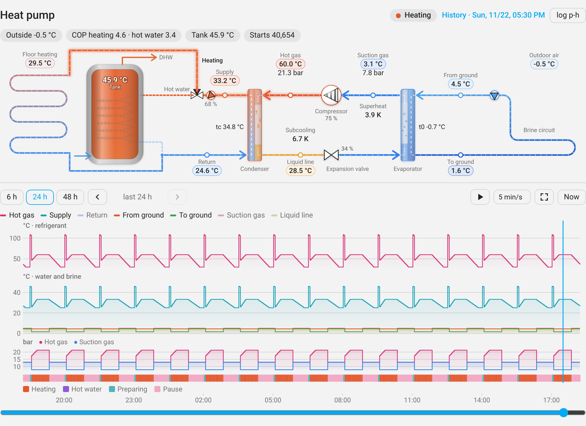

# ViCare Heat Pump Card

A Home Assistant Lovelace card for Viessmann heat pumps (ground and air source) connected through the built-in **ViCare** integration. It draws the refrigerant circuit the way the heat pump's own service display does, lets you scrub and play back the history, and shows the operating point in a **log p-h diagram** with an indicative health check.

*Suomenkielinen ohje on alempana.*




## Features

- **Refrigerant circuit**: hot gas and suction gas (temperature and pressure), liquid line, condensing (tc) and evaporating (t0) temperatures, subcooling, superheat, heating water and brine temperatures. Pipes are coloured by temperature and moving dots show the flow while the pumps and the compressor run.
- **Heat exchangers**: the condenser shows desuperheating, condensing and subcooled liquid, the evaporator boiling and superheating. The zone heights follow the measured superheat and subcooling.
- **Heating circuit, hot water cylinder and brine loop** on wide cards: floor heating loop (or radiators), a second heating circuit when the device has one, the cylinder with its coil and a stratification estimate from the single top sensor, the brine pump and loop. A DHW circulation pump is drawn only if its history shows that it has run.
- **Air source heat pumps**: an outdoor unit with the finned coil and the fan instead of the brine loop, and a 4-way valve. In defrost (and active cooling) the valve reverses the cycle: the hot gas goes to the outdoor coil, the fan stops and the heat is taken from the water. Preparing defrost and passive defrost (fan only) are shown too.
- **Speeds**: compressor % or rps, expansion valve opening, fan, brine and circulation pump speeds are shown when available, and the flow animations and pumps run faster or slower with them.
- **Operating state**: heating, hot water, preparing, pause, defrost or off.
- **Trends**: temperatures and pressures with a band for every run. Drag across the chart or use the slider to see the circuit at any moment, step a day back or forward, play the history (1, 2 or 5 min/s) or enlarge the charts to read every value at the cursor.
- **Units without a high pressure sensor** (e.g. Vitocal 250-A, 252-A, 200-A, 222-S): the condensing temperature is estimated from the liquid line and the supply water and marked with ≈; the checks that depend on it are left out.
- **log p-h diagram** with the cycle points, the source and supply temperature levels, a point table and a health check (superheat, subcooling, hot gas temperature, approaches, ΔT). Air source units are checked against outdoor air; defrost and cooling are not assessed, and the check waits for operation to settle after a defrost.
- **Logbook** (optional): the heat pump's own event log, kept in a CSV file and shown in the card and on the timeline. Vitotronic 200 (WO1C) units (Vitocal 300-G, 333-G, older 200-S/222-S) have a real logbook. Newer units (Vitocal 250-A, 252-A, 200-A, 151-A, newer 222-S) have none; for them the script logs the status, info, service and fault messages (S.125 heating, S.128 defrost, S.115 valve to hot water …) as they appear, with the unit's own time stamps.
- **Disabled sensors**: most refrigerant sensors of the ViCare integration are disabled by default. For an administrator the card lists the disabled ones it would use and enables them with one button.
- No entity IDs to set up: entities are found from the ViCare integration's own sensor keys. English, Finnish, Swedish and German, light and dark themes, phone layout.

<!-- ha-marketplace:exclude-start -->
## Installation

### Marketplace (Home Assistant 2026.11 and newer)

1. Settings → **Marketplace** → *Add from link* → this repository's URL (`https://github.com/fraatti/vicare-heatpump-card`). Adding a repository by link asks you to connect GitHub once.
2. Open **ViCare Heat Pump Card**, choose *Install* and reload the browser. Updates appear like any other update.

### HACS (Home Assistant before 2026.11)

1. HACS → ⋮ → *Custom repositories* → add this repository's URL, type **Dashboard**.
2. Install **ViCare Heat Pump Card** and reload the browser.

### Manual

1. Copy `dist/vicare-heatpump-card.js` to `/config/www/vicare-heatpump-card.js`.
2. Settings → Dashboards → ⋮ → *Resources* → *Add resource*: URL `/local/vicare-heatpump-card.js?v=1`, type *JavaScript module*. Raise the `v` number after every update.
3. Reload the browser.
<!-- ha-marketplace:exclude-end -->

## Configuration

```yaml
type: custom:vicare-heatpump-card
refrigerant: R410A       # R410A, R32, R290, R134a, R407C
hours: 24                # 6, 24 or 48; the buttons change it on the fly
```

| Option | Default | Description |
|---|---|---|
| `device_id` | first ViCare heat pump | Device to show |
| `extra_devices` | – | More ViCare devices whose sensors are used, e.g. the outdoor unit of a split system. Other heat pump devices of the same ViCare account are used automatically for sensors the main device lacks |
| `title` | "Heat pump" | Card title |
| `refrigerant` | `R410A` | Used for tc, t0 and the log p-h diagram; check the rating plate |
| `hours` | `24` | Trend length |
| `language` | `auto` | Card language: `auto` (Home Assistant's language), `en`, `fi`, `sv`, `de` |
| `source` | `auto` | Heat source: `ground` (brine loop) or `air` (outdoor unit). `auto` picks air when there is no brine return sensor and no brine pump |
| `heating_circuit` | `floor` | `floor` (floor heating loop) or `radiators` |
| `buffer` | `auto` | Buffer cylinder between the heat pump and the heating circuit: `auto` (drawn if a buffer temperature sensor exists), `yes`, `no` |
| `mixer` | `false` | Mixing valve (shunt) in the heating circuit |
| `heating_circuit_2` | `auto` | Second heating circuit: `auto` (drawn as radiators if the device has a second supply temperature or circulation pump, i.e. ViCare entities ending in `_2`), `none`, `floor`, `radiators`. The two circuits are drawn one above the other and take their water from the same buffer outlet or supply pipe |
| `mixer_2` | `false` | Mixing valve in the second heating circuit |
| `circuit_name` / `circuit_name_2` | – | Names shown on the circuits instead of "Floor heating" / "Radiators" (or "Heating circuit 1" / "Heating circuit 2" when two circuits are drawn) |
| `heater` | `auto` | Electric flow-through heater after the condenser: `auto` (drawn if the `heater` sensor is set), `yes`, `no` |
| `show_logbook` / `log_markers` | `true` | Logbook text list / logbook markers on the timeline |
| `cold_water` | `10` | Cold mains water temperature for the cylinder estimate |
| `show_trend`, `show_info`, `show_logbook` | `true` | Parts of the card |
| `steady_minutes` | `10` | Minutes from compressor start before the health check |
| `entities` | – | Use your own entity for any role, e.g. `entities: { hot_gas_p: sensor.my_pressure }`. Also in the visual editor under *Sensors*. The card works without the ViCare integration when the roles are set here. |

Roles: `hot_gas_t`, `hot_gas_p`, `suction_t`, `suction_p`, `liquid_t`, `subcooling`, `superheat`, `eev`, `compressor`, `comp_speed`, `phase`, `starts`, `sec_supply`, `sec_return`, `circ_pump`, `circ_pump_speed`, `dhw_charging`, `dhw_top`, `dhw_circ`, `buffer_t`, `circ_supply`, `mixer`, `circ_supply_2`, `circ_pump_2`, `circ_pump_speed_2`, `mixer_2`, `heater`, `pri_supply`, `pri_return`, `pri_pump`, `fan`, `outside`, `power`, `cop_heating`, `cop_dhw`, `cop_total`. `comp_speed` is found automatically on inverter units (`compressor_modulation`); your own sensor may give rps instead. `circ_supply_2` and `circ_pump_2` are the second heating circuit's supply temperature and circulation pump (the second ViCare entity of the same kind, e.g. `sensor.…_supply_temperature_2`). `circ_pump_speed`, `circ_pump_speed_2`, `mixer`, `mixer_2`, `heater`, `fan` (fan speed %), `eev` (expansion valve opening %) and `power` (input power of the unit from your own meter, W or kW; shown in the header, hidden when not set) are not provided by the ViCare integration; point them to your own sensors if you have them. Each heating circuit is coloured by its own supply temperature; a circuit without a supply sensor is drawn in the colour of the water it takes (buffer top or heat pump supply).

Most refrigerant circuit sensors of the ViCare integration are **disabled by default**. The card lists them under the diagram; an administrator can enable them there with *Enable* (Home Assistant reloads the integration about 30 seconds later). Or open the device page, choose *+ N entities not shown* and enable them there. Sensors the device does not have are listed separately.

## Optional extras (`examples/`)

Copy the packages to `/config/packages` (`homeassistant: packages: !include_dir_named packages` in `configuration.yaml`). The entity IDs are those of a Vitocal 333-G (`cu401b_g_*`); change them for your unit.

| File | What it does |
|---|---|
| `packages/heatpump_tc_t0.yaml` | tc and t0 as sensors (history and statistics) |
| `packages/heatpump_weekly.yaml` | Weekly means during runs, run lengths and runtimes, kept in long-term statistics |
| `packages/heatpump_logbook.yaml` + `vicare_logbook.py` | Keeps the device logbook (`/config/vicare_logbook.csv`) and notifies about unusual entries. On units without a logbook it logs the device messages instead (fault and service messages are notified, also when they clear). Uses the ViCare integration's own token, which is never printed or stored; 48 API calls a day. Message times are taken as UTC and shown in Home Assistant's time zone. Copy `vicare_codes.json` next to the script for the texts of about 1 850 message codes (from [open3e](https://github.com/open3e/open3e), Apache-2.0) |
| `heatpump-dashboard.yaml` | Example dashboard with the card, the packages and history views |

## Development

`demo/index.html` shows the card without Home Assistant. It has a synthetic Vitocal 333-G with a 24-hour history (`demo/mock.js`) and snapshots of real units from [PyViCare](https://github.com/openviess/PyViCare)'s test data (Apache-2.0): Vitocal 250-A, 252-A, 222-S, 200-A (two ViCare devices) and 333-G. `tools/make_demo_models.py` rebuilds `demo/models.js` from those files. Open the page directly or through any local web server; URL parameters: `model`, `lang`, `source`, `phase`, `buffer`, `mixer`, `circuit`, `heater`, `split`, and for a second heating circuit `circuits=2` (adds `supply_temperature_2` and `circulation_pump_2` to the synthetic unit), `circuit2` (`floor`, `radiators`, `none`), `mixer2=1`, `name1`, `name2`.

## Limitations

- ViCare is cloud polled; values change every minute or two and short "unavailable" gaps are bridged.
- History goes back as far as the recorder keeps it (10 days by default).
- The health check limits are general guidance for ground and air source heat pumps, not manufacturer values, and it is no substitute for service.
- Tested in use with a Vitocal 333-G (CU401B_G, R410A); air source models only with the API snapshots above. Feedback from other models is welcome; please attach your ViCare diagnostics file to an issue.

Refrigerant properties were generated with [CoolProp](http://www.coolprop.org/).

---

## Suomeksi

Kortti näyttää Viessmann-lämpöpumpun kylmäainepiirin samaan tapaan kuin laitteen oma huoltonäyttö. Siinä on lisäksi lattialämmitys, käyttövesivaraaja ja liuospiiri, trendit, historian kelaus ja toisto sekä log p-h -piirros, jossa on suuntaa antava arvio toiminnasta. Kortti käyttää ViCare-integraation omia tietoja ja tunnistaa anturit itse.

**Asennus**
1. Asetukset → *Marketplace* → *Add from link* → tämän repositorion osoite (Home Assistant 2026.11 alkaen; vanhemmissa HACS → ⋮ → *Custom repositories*, tyyppi *Dashboard*). Tai kopioi `dist/vicare-heatpump-card.js` kansioon `/config/www/` ja lisää resurssi `/local/vicare-heatpump-card.js?v=1` (JavaScript-moduuli).
2. Ota käyttöön kylmäainepiirin anturit (kuumakaasu, imukaasu, nestelinja, alijäähdytys, tulistus). Kortti luettelee käytöstä poistetut anturit, ja ylläpitäjä voi ottaa ne käyttöön kortin *Ota käyttöön* -napista. Laitteelta puuttuvat anturit kortti listaa erikseen.
3. Lisää kortti kortinvalitsimesta (*ViCare Heat Pump Card*).

**Käyttö**
- Raahaa kuvaajaa tai liukusäädintä, niin kaavio näyttää valitun hetken. ‹ ja › vaihtavat päivää, ▶ toistaa historiaa, ⤢ suurentaa kuvaajat ja näyttää lukemat kohdistimen kohdalla, *Nyt* palaa nykyhetkeen.
- *log p-h* avaa kiertoprosessin piirroksen ja arvion, kun kompressori on käynyt vähintään 10 minuuttia.

**Mallit ilman korkeapaineanturia** (esim. Vitocal 250-A, 252-A, 200-A, 222-S): lauhtumislämpötila arvioidaan nestelinjan ja menoveden lämpötilasta ja merkitään ≈-merkillä; siitä riippuvat kohdat jätetään arviosta pois.

**Ilma-vesilämpöpumppu.** Asetuksella `source: air` (tai automaattisesti, jos liuoksen paluuanturia ja liuospumppua ei ole) liuospiirin tilalle piirretään ulkoyksikkö, lamellipatteri, puhallin ja 4-tieventtiili. Sulatuksessa venttiili kääntää kierron: kuumakaasu menee ulkoyksikön patteriin, puhallin pysähtyy ja lämpö otetaan vedestä.

**Nopeudet.** Kompressorin nopeus (% tai rps), paisuntaventtiilin avaus, puhaltimen sekä liuos- ja kiertovesipumpun nopeus näytetään, jos anturi on, ja virtausanimaatiot nopeutuvat tai hidastuvat niiden mukaan.

**Lämmönjako.** Asetuksissa valitaan lattialämmitys tai patterit, puskurivaraaja (`buffer`), shuntti (`mixer`) ja sähkövastus (`heater`). Toinen lämmityspiiri (`heating_circuit_2`, `mixer_2`) piirretään ensimmäisen alle, kun laitteella on toinen menovesianturi tai kiertovesipumppu (`_2`-loppuiset entiteetit), tai kun piirin tyyppi valitaan asetuksista. Kumpikin piiri värittyy oman menovetensä mukaan, ja piireille voi antaa nimet (`circuit_name`, `circuit_name_2`). Osiosta *Anturit* jokaisen arvon voi vaihtaa omaan entiteettiin, myös ilman ViCare-integraatiota.

**Lisäosat** (`examples/`): tc/t0-anturit, viikkotilastot, tapahtumaloki ja valmis kojelauta. Tapahtumaloki toimii Vitotronic 200 (WO1C) -koneissa (300-G, 333-G, vanhemmat 200-S/222-S) laitteen omasta lokista; uudemmissa (250-A, 252-A, 200-A, 151-A) skripti kirjaa laitteen tila-, info-, huolto- ja vikaviestit (esim. S.125 lämmitys, S.128 sulatus) niiden ilmestyessä. Kopioi `vicare_codes.json` skriptin viereen, niin noin 1 850 koodille tulee selitys (yleisimmät suomeksi, muut englanniksi). Entiteetti-ID:t ovat Vitocal 333-G:n; vaihda ne omaan laitteeseen sopiviksi.

Split-mallin sisä- ja ulkoyksikkö näkyvät ViCaressa kahtena laitteena; kortti yhdistää niiden anturit itse, tai ulkoyksikön voi valita asetuksesta *Muut laitteet*.

Arvion rajat ovat yleisiä ohjearvoja maa- ja ilmalämpöpumpuille, eivät valmistajan arvoja, eikä arvio korvaa huoltoa.

## Svenska

Kortet visar Viessmann-värmepumpens köldmediekrets på samma sätt som aggregatets egen servicedisplay. Dessutom visas golvvärme eller radiatorer, varmvattenberedare och köldbärarkrets (eller utedel), trender, uppspelning av historiken och ett log p-h-diagram med en vägledande bedömning av driften. Kortet använder den inbyggda ViCare-integrationens data och hittar givarna själv. Språket följer Home Assistants språkinställning.

**Två värmekretsar.** En andra värmekrets (`heating_circuit_2`, `mixer_2`) ritas under den första när aggregatet har en andra framledningsgivare eller cirkulationspump (entiteter som slutar på `_2`), eller när kretsens typ väljs i inställningarna. Varje krets färgas efter sin egen framledningstemperatur, och kretsarna kan få egna namn (`circuit_name`, `circuit_name_2`).

**Installation**
1. Inställningar → *Marketplace* → *Add from link* → det här repositoriets adress (Home Assistant 2026.11 och senare; i äldre versioner HACS → ⋮ → *Custom repositories*, typ *Dashboard*). Eller kopiera `dist/vicare-heatpump-card.js` till `/config/www/` och lägg till resursen `/local/vicare-heatpump-card.js?v=1` (JavaScript-modul).
2. Aktivera köldmediekretsens givare (hetgas, suggas, vätskeledning, underkylning, överhettning); de flesta är inaktiverade från början. Kortet listar de inaktiverade givarna och en administratör kan aktivera dem med knappen *Aktivera*. Givare som aggregatet saknar listas separat.
3. Lägg till kortet från kortväljaren (*ViCare Heat Pump Card*).

**Loggbok** (`examples/`): skriptet `vicare_logbook.py` sparar aggregatets loggbok, eller på nyare modeller dess status-, info-, service- och felmeddelanden. Lägg till `--lang sv` i kommandot för svenska texter.

Bedömningens gränser är allmänna riktvärden för berg- och luftvärmepumpar, inte tillverkarens värden, och ersätter inte service.

## Deutsch

Die Karte zeigt den Kältekreis einer Viessmann-Wärmepumpe so wie das Servicedisplay des Geräts. Dazu kommen Fußbodenheizung oder Heizkörper, Warmwasserspeicher und Solekreis (oder Außeneinheit), Trends, Wiedergabe des Verlaufs und ein log p-h-Diagramm mit einer orientierenden Bewertung des Betriebs. Die Karte nutzt die Daten der integrierten ViCare-Integration und findet die Sensoren selbst. Die Sprache folgt der Spracheinstellung von Home Assistant.

**Zwei Heizkreise.** Ein zweiter Heizkreis (`heating_circuit_2`, `mixer_2`) wird unter dem ersten gezeichnet, wenn das Gerät einen zweiten Vorlaufsensor oder eine zweite Heizkreispumpe hat (Entitäten mit der Endung `_2`) oder wenn der Typ des Kreises in den Einstellungen gewählt ist. Jeder Kreis wird nach seiner eigenen Vorlauftemperatur eingefärbt, und die Kreise können eigene Namen erhalten (`circuit_name`, `circuit_name_2`).

**Installation**
1. Einstellungen → *Marketplace* → *Add from link* → Adresse dieses Repositorys (ab Home Assistant 2026.11; in älteren Versionen HACS → ⋮ → *Custom repositories*, Typ *Dashboard*). Oder `dist/vicare-heatpump-card.js` nach `/config/www/` kopieren und die Ressource `/local/vicare-heatpump-card.js?v=1` (JavaScript-Modul) hinzufügen.
2. Die Sensoren des Kältekreises aktivieren (Heißgas, Sauggas, Flüssiggas, Unterkühlung, Überhitzung); die meisten sind standardmäßig deaktiviert. Die Karte listet die deaktivierten Sensoren auf, ein Administrator kann sie mit *Aktivieren* einschalten. Sensoren, die das Gerät nicht hat, werden getrennt aufgeführt.
3. Die Karte über die Kartenauswahl hinzufügen (*ViCare Heat Pump Card*).

**Logbuch** (`examples/`): Das Skript `vicare_logbook.py` speichert das Logbuch des Geräts bzw. bei neueren Modellen die Status-, Info-, Service- und Störungsmeldungen. Für deutsche Texte `--lang de` an den Befehl anhängen.

Die Grenzwerte der Bewertung sind allgemeine Richtwerte für Sole/Wasser- und Luft/Wasser-Wärmepumpen, keine Herstellerwerte, und ersetzen keine Wartung.

## License

MIT
